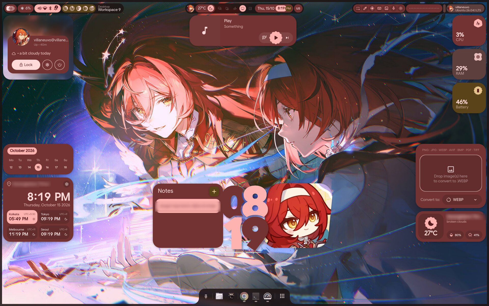
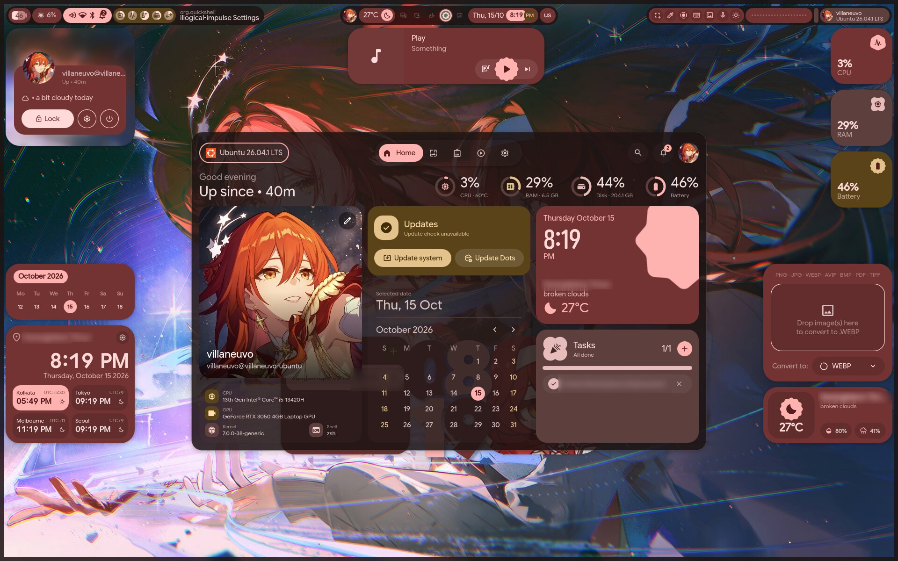
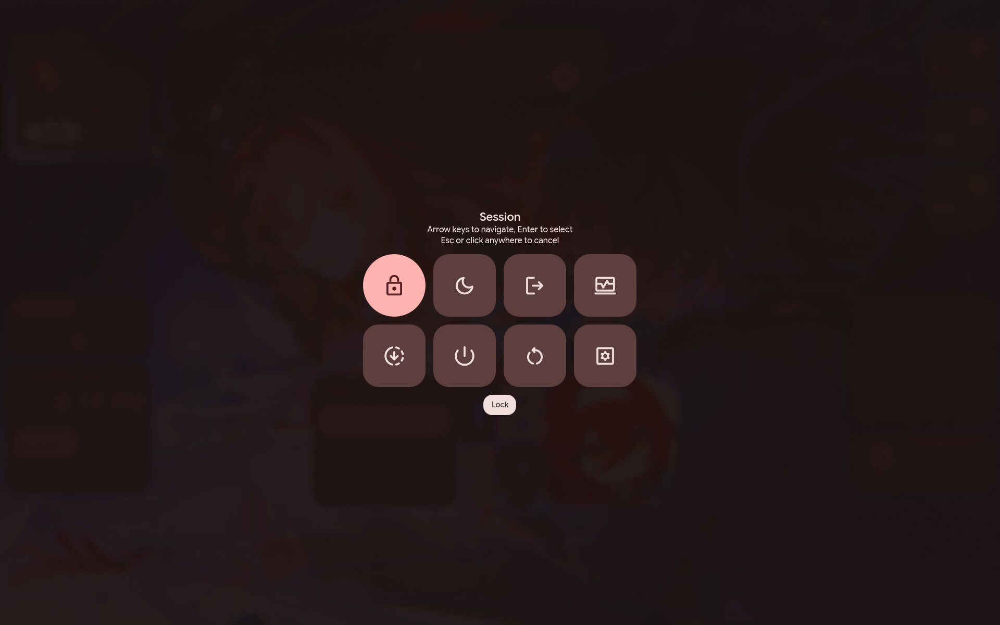
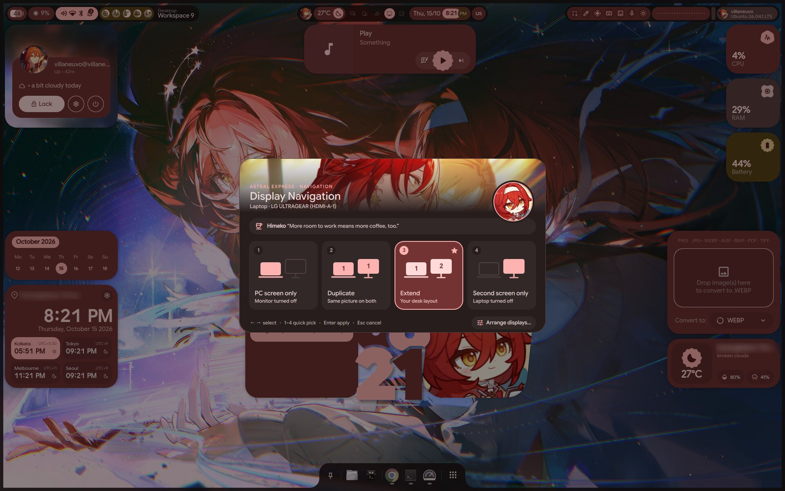
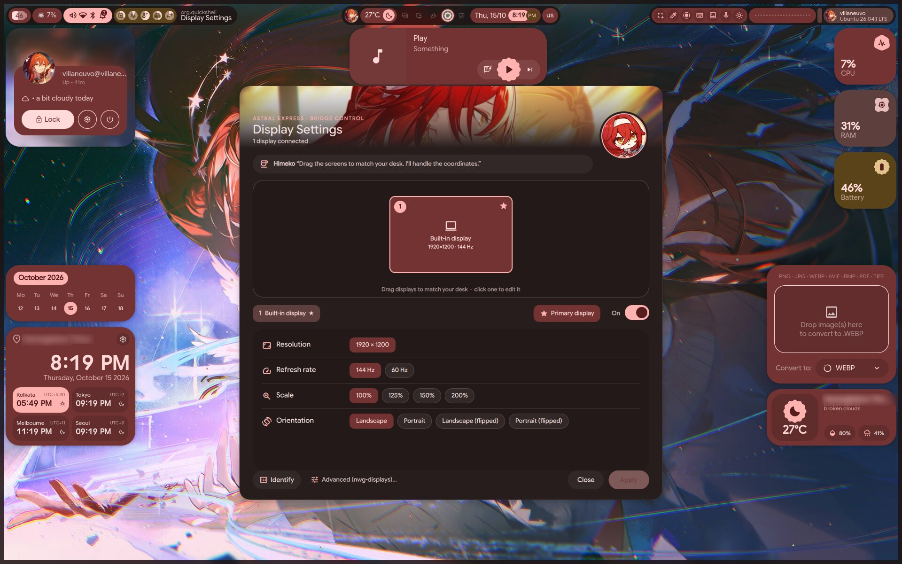

<div align="center">

# 💠 VHyprland-End4-pC

**Hyprland on Ubuntu 26.04 with [illogical-impulse](https://github.com/end-4/dots-hyprland) and the [end4-pC](https://github.com/pctrade/end4-pC) shell**  
Himeko preset · Ubuntu fixes · display tools · one-command install

*V for **Villaneuvo***

</div>

---

## 📸 Screenshots

<p align="center">
  
</p>

<div align="center">

| 🏠 Dashboard (`Super+Esc`) | ⏻ Session Menu |
|:---:|:---:|
|  |  |
| 🖥️ Display Navigation (`Super+Alt+P`) | 🛠️ Display Settings |
|  |  |

</div>

---

## ✨ Features

- 🎨 **end4-pC + the Himeko preset** on top of illogical-impulse, running on stock Ubuntu (no Arch, no Nix)
- 🖥️ **Display Navigation**: a Windows+P style picker (PC only / Duplicate / Extend / Second screen only)
- 🛠️ **Display Settings**: drag to arrange monitors, resolution, refresh rate, scale, orientation, primary display,
  Identify, and an automatic revert after 15 s if the new layout is unusable
- 🔔 **Notifications that open their app on click**, like GNOME or Windows (no extra *Activate* button), and proper
  icons for Chrome notifications
- 💤 **Sleep that turns into hibernate**: suspend instantly, hibernate on its own after 2 hours (opt-in)
- 🔊 **Desktop polish**: volume tick sound, a shutter sound and a notification for every screenshot, USB automount,
  SMART disk warnings, Ubuntu update notifications, night light
- 🧩 **Intel + NVIDIA laptops**: Hyprland renders on the iGPU, and screen sharing works

---

## ⚡ Installation

> [!NOTE]
> Run it **from a terminal inside your normal (GNOME) session**, as your user. It asks for your sudo password, takes a
> while (it builds Quickshell), and is safe to re-run.

```bash
sudo apt install gh && gh auth login     # the repo is private: log in first (GitHub.com → HTTPS → browser)
gh repo clone Villaneuvo/VHyprland-End4-pC ~/VHyprland-End4-pC
cd ~/VHyprland-End4-pC
./install.sh
```

When it finishes, log out and pick the **Hyprland** session on the login screen (not "Hyprland (uwsm-managed)").
Then set the AI sidebar keys again (`Super+A`, then `/key`): keys live in the keyring, not in this repo.

### 🔄 Keeping it up to date

```bash
./sync.sh                                # copy the live files listed in manifest.txt into home/
git commit -am "Update dotfiles" && git push
```

On another machine: `git pull && ./install.sh files` copies only the config files.

---

## ⌨️ Keybinds

| Keys | Action |
|---|---|
| `Super+Esc` | Dashboard and settings (presets, wallpapers) |
| `Super+Alt+P` | Display Navigation |
| `Super+Alt+Shift+P` | Reset displays to the configured layout |
| `Super+Shift+L` | Sleep (suspend, then hibernate after 2 h when enabled) |
| `Print` / `Ctrl+Print` | Screenshot to the clipboard / to the clipboard and `~/Pictures/Screenshots` |
| `Super+Shift+S` | Region screenshot (also saved to `~/Pictures/Screenshots`) |

Everything else is illogical-impulse's: open the launcher (`Super`) and type `<` for the full list.

---

## 💤 Hibernate (opt-in)

Ubuntu disables hibernation. `./enable-hibernate.sh` turns it on:

- **Hibernate** in the session menu hibernates straight away.
- **Sleep** (lid, sleep key, `Super+Shift+L`, session menu) suspends at once and hibernates after 2 hours
  (`DELAY=90min ./enable-hibernate.sh` to change it).

> [!TIP]
> The screen goes black while the image is written. After a long day with many apps open that can take a minute or
> two: wait until the power light goes off. Switching off early loses the image and the next boot starts fresh.

<details>
<summary>How it works and how to undo it</summary>

- A 32 GB swap file (`/swap-hibernate.img`, beside the normal one) and a polkit rule overriding Ubuntu's block.
- dracut's `resume` module and `lz4` in the running kernel's initramfs; images are written with lz4 (faster than
  the default lzo). The script checks the new initramfs still has `crypt`/`lvm`/`resume`/`lz4` and restores the old
  one otherwise.
- No kernel parameters: systemd ≥ 255 passes the resume location through an EFI variable. Works with LUKS (you type
  the disk password on resume, as on a normal boot).
- `HibernateDelaySec`, logind's lid/sleep-key actions and `nvidia-suspend-then-hibernate.service` for the Sleep part.

**Undo:** `sudo swapoff /swap-hibernate.img && sudo rm /swap-hibernate.img`, delete its `/etc/fstab` line,
`sudo rm /etc/polkit-1/rules.d/40-allow-hibernate.rules /etc/dracut.conf.d/90-hibernate-resume.conf
/etc/tmpfiles.d/hibernate-lz4.conf /etc/systemd/sleep.conf.d/90-suspend-then-hibernate.conf
/etc/systemd/logind.conf.d/90-suspend-then-hibernate.conf`, `sudo systemctl reload systemd-logind`,
`sudo update-initramfs -u`. If a boot ever fails: GRUB → Advanced options → the older kernel.

</details>

---

## 🔧 Under the hood

<details>
<summary>What install.sh does</summary>

| Step | Why |
|---|---|
| PPAs `cppiber/hyprland`, `marin-m/songrec` (keys in `keys/`) | Ubuntu ships Hyprland 0.53; the Lua config needs ≥ 0.55. SongRec isn't in Ubuntu. |
| apt packages from `packages.txt` | Everything dots-hyprland's Arch packages would pull in, mapped to Ubuntu names. Removes Ubuntu's `libudis86-0` first: the PPA's `libudis86.1` clashes with it. |
| Builds Quickshell at the commit dots-hyprland pins | Not packaged for Ubuntu. Built with Ubuntu's QML path and without the crash handler (no `cpptrace`). |
| uv, matugen, Material Symbols / Rubik / Readex Pro / JetBrains Mono Nerd fonts, adw-gtk3, Darkly | Not in Ubuntu's repos. |
| dots-hyprland `./setup install --skip-alldeps` with a local `os-release` saying `ID=arch` | Its installer forces a broken Nix route on Ubuntu. |
| Patches ii (`FluentWinUI3` import) and end4-pC (`var double`, Logout, Sleep, notifications) | Ubuntu's Qt 6.10 rejects the first two, so the shells don't load. end4-pC's Logout (`pkill Hyprland`) gets undone by the `start-hyprland` watchdog, so it uses `hyprshutdown`. `custom/scripts/end4pc-patches.sh` re-applies the end4-pC patches at every login, because end4-pC's updater re-clones itself. |
| Copies `home/` (see `manifest.txt`) | All the customizations. Replaced files are backed up to `~/.dotfiles-backup/`. |
| Masks `waybar`, `swaync`, `hypridle`, `hyprsunset` user services | They start via `graphical-session.target` and fight end4-pC or duplicate ii's autostart. |
| `plasma-applications.menu` symlink | Dolphin's "Open with" list is empty without it. |
| Intel + NVIDIA laptops: udev rule for `/dev/dri/intel-igpu` and `nvidia-dgpu` | Hyprland renders on the iGPU (`custom/env.lua`). Skipped on other hardware. |
| fisher + nvm.fish, nwg-displays 0.4.4 (venv), mpvpaper | Node in fish, advanced monitor settings (Ubuntu's 0.3.x can't write Lua), video wallpapers. |

Pinned versions (top of `install.sh`): dots-hyprland `2f2a376`, end4-pC `96b45aa`, matugen 4.2.0, nwg-displays 0.4.4.
Try newer ones with `DOTS_REF=main END4_REF=main ./install.sh`, at your own risk: newer upstream may need a newer
Hyprland/Qt than Ubuntu has.

</details>

<details>
<summary>Where the customizations live</summary>

Everything is in files dots-hyprland never overwrites:

- `~/.config/hypr/custom/`: env, autostart (`execs.lua`), keybinds, rules, scripts, the display tools
- `~/.config/hypr/monitors.lua`: this laptop's monitor layout (harmless elsewhere: unknown monitors are placed
  automatically; use **Display Settings** to redo it)
- `~/.config/hypr/xdph.conf`: `force_shm` (screen sharing on Intel+NVIDIA) and a pre-ticked restore token
- `~/.config/hyprland-mimeapps.list`: Image Viewer for images, VLC for video (GNOME's list is ignored under Hyprland)
- fish `conf.d`: the same PATH as `.zshrc`, nvm.fish in `~/.local/share/fisher`
- `~/.config/illogical-impulse/`: end4-pC settings and the Himeko preset
- `custom/scripts/idle-monitor-shim.py`: GNOME's idle-time D-Bus API for apps that check it (physical input only)

</details>

---

## 🩺 Troubleshooting

- **Bar, wallpaper and widgets gone** after updating end4-pC: log out and back in, or run
  `~/.config/hypr/custom/scripts/end4pc-qt610-fix.sh`.
- **After updating dots-hyprland** (`./setup install`): it resyncs `~/.config/quickshell`, which deletes end4-pC.
  Run `./install.sh` again (it re-clones and re-patches).
- **apt upgraded Qt**: rebuild Quickshell (delete `~/src/quickshell/build`, re-run `./install.sh`).
- **Broken icons in GTK apps** (a page with a warning sign): the GTK icon theme got set to a cursor theme.
  `gsettings reset org.gnome.desktop.interface icon-theme`.
- **Screen frozen after resuming from hibernate** (seen twice, not reproduced since): before powering off, try
  `Ctrl+Alt+F3`, then `Ctrl+Alt+F2`. Switching VTs makes Hyprland set the screen up again.
- Check the Hyprland config: `Hyprland --verify-config`. Shell logs: `qs log -c end4-pC`.

---

## 🙏 Credits

- **[@end-4](https://github.com/end-4)**: [dots-hyprland](https://github.com/end-4/dots-hyprland) / illogical-impulse
- **[@pctrade](https://github.com/pctrade)**: [end4-pC](https://github.com/pctrade/end4-pC) and the
  [presets gallery](https://github.com/pctrade/end4-pCpresets)
- **@Blapples**: the Himeko preset

Himeko artwork © its creators / HoYoverse; kept here for personal use, which is one reason this repo is private.
